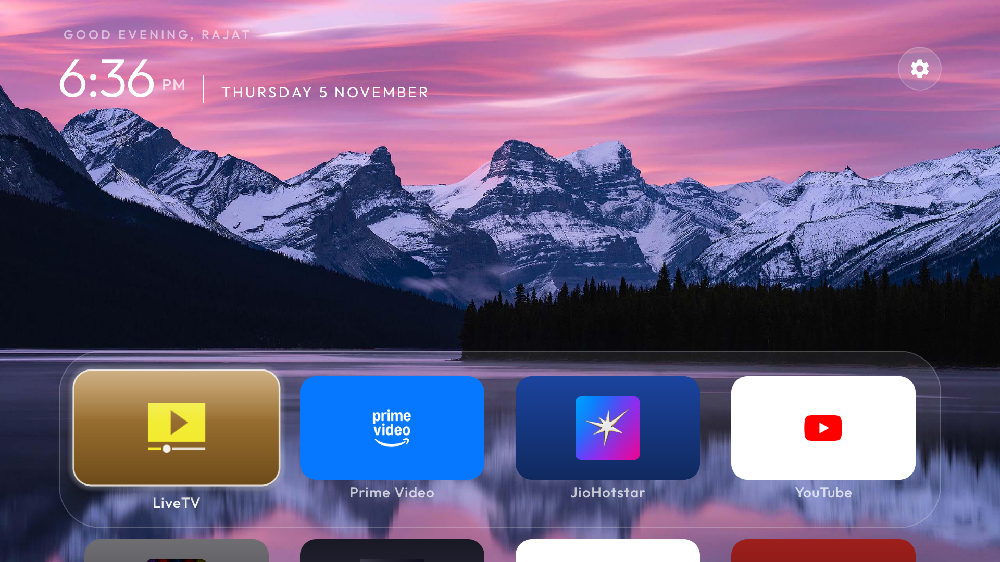

<div align="center">

# 🚀 EVA TV Launcher

<b>A lightweight, blazing-fast, remote-friendly Android TV launcher featuring a 1-Click Online Theme Store, Native Module Card Widgets, Reddit Wallpaper Sync, and GitHub OTA Updates.</b>

<p align="center">
  <a href="https://github.com/therajatshahare/eva-launcher"></a>
  <a href="https://developer.android.com/about/versions/oreo"></a>
  <a href="https://github.com/therajatshahare/eva-launcher/releases/latest"></a>
  <a href="LICENSE"></a>
  <a href="https://github.com/gradle/gradle"></a>
</p>

</div>

---

## 📸 Interface Showcase

<div align="center">

### 📺 Home Screen & Glass Dock


### 🎨 Online Theme Store & Custom Themes
| Cinema Dusk Theme | Minimal List Theme |
| :---: | :---: |
|  |  |

</div>

---

## 🌟 Key Features

### ⚡ Blazing-Fast & Ultra-Lightweight
- **Zero Bloatware:** Base APK is roughly ~530 KB, built with plain Java and minimal dependencies.
- **R8 Optimized:** Code stripping and resource shrinking enabled for instantaneous startup and minimal RAM overhead on low-spec TV processors.

### 🎨 1-Click Online Theme Store
- **Browse & Install Online:** Browse community themes (`Cinema Dusk`, `tvOS Dusk`, `Minimal List`) and apply them with **1-click** directly on your TV.
- **Dynamic Themes:** Supports glassmorphism dock bands, custom column layouts, and vertical text-only list views (`list_layout`).

### 📱 Native Module Cards & Widgets
- **TV-Optimized Widgets:** Support for widescreen 16:9 Module Cards (Weather, Clock, Live Scores, Movie Highlights).
- **Security & Permissions:** Cryptographically locked permissions in `cards.json` ensure apps cannot inject cards without your consent.

### 🖼️ Live Reddit Wallpaper Synchronization
- **`r/wallpapers` Integration:** Fetches high-definition landscape artwork directly from Reddit's `r/wallpapers`.
- **De-Duplication & Memory Protection:** Hashes image URLs to prevent duplicate downloads and downsamples images to protect low-RAM TV boxes.

### ☕ Support Development ("Buy Me a Chai")
- **UPI QR Support:** Integrated TV-friendly support dialog allowing users in India to support development via Google Pay, PhonePe, Paytm, or BHIM.

### 🔄 GitHub OTA Auto-Updates
- **In-App Updater:** Check for new releases directly from settings (`UpdateManager.java`).
- **Seamless Install:** Downloads and prompts for installation via `UpdateFileProvider`, a custom lightweight `ContentProvider`.

---

## ⚙️ How Theme Addons & Cards Work

### 1. Online Theme Store (`ThemeFetcher.java`)
- Fetches the central theme index from `https://raw.githubusercontent.com/therajatshahare/eva-launcher/main/themes/index.json`.
- Downloads and extracts `theme.zip` directly into `Android/data/io.rns.evalauncher/files/`.
- Rebuilds the launcher UI instantly in 1-click.

### 2. Module Card Addon Standard (`Cards.java`)
Installed apps declare cards in `AndroidManifest.xml`:
```xml
<activity
    android:name=".WeatherCardActivity"
    android:exported="true"
    android:label="Weather Live">
    <intent-filter>
        <action android:name="android.intent.action.MAIN" />
        <category android:name="android.intent.category.LEANBACK_LAUNCHER" />
        <category android:name="io.rns.evalauncher.category.DOCK_CARD" />
    </intent-filter>
    <meta-data
        android:name="io.rns.evalauncher.card"
        android:resource="@xml/card_weather_spec" />
</activity>
```

---

## 📋 Requirements

- Android TV / Google TV device running **Android 8.0 (API 26) or higher**.
- Permissions: `INTERNET` and `REQUEST_INSTALL_PACKAGES`.

---

## 📥 Installation

1. Download `app-release.apk` from the [Latest Release](https://github.com/therajatshahare/eva-launcher/releases/latest).
2. Sideload the APK onto your Android TV using ADB or a file manager app (e.g., Downloader).
3. Open **EVA TV Launcher** and optionally set it as your default Home launcher.

Using ADB:
```bash
adb connect <tv-ip-address>:5555
adb install -r app-release.apk
```

---

## 📦 Building from Source

### Prerequisites
- JDK 17
- Android SDK (Compile SDK 34, Min SDK 26)

### Build Commands

**Linux / macOS:**
```bash
./gradlew assembleRelease
```

**Windows (PowerShell):**
```powershell
.\gradlew.bat assembleRelease
```

Output APK path: `app/build.gradle` -> `app/build/outputs/apk/release/app-release.apk`.

---

## 📁 Project Structure

```text
eva-launcher/
├── .github/workflows/release.yml     # CI/CD auto-release workflow
├── app/
│   ├── build.gradle                  # App configuration, SDK 34, R8 shrinking
│   └── src/main/
│       ├── AndroidManifest.xml       # Permissions, UpdateFileProvider
│       ├── java/io/rns/evalauncher/
│       │   ├── LauncherSettingsActivity.java
│       │   ├── ThemeFetcher.java
│       │   ├── WallpaperFetcher.java
│       │   ├── UpdateManager.java
│       │   └── ...                   # Core launcher components
│       └── res/                      # UI layouts, fonts, drawables, strings
├── themes/                           # Online Theme Store packages & index.json
├── README.md
└── LICENSE
```

---

## 🔒 Privacy

EVA makes network requests only when triggered by user actions:
- `reddit.com` for fetching wallpapers
- `raw.githubusercontent.com` for theme store downloads & index
- `api.github.com` for update checks and release downloads

No telemetry, no tracking, and no external advertising services.

---

## 👥 Credits & Acknowledgments

- **Original Base:** Built upon the [CleanYourTV](https://github.com/Gathin23/cleanyourtv) project created by **[Gathin23](https://github.com/Gathin23)**.
- **Lead Developer:** **Rajat Shahare** ([@therajatshahare](https://github.com/therajatshahare)).
- **Font:** Uses the [Outfit](https://github.com/outfit-project/outfit-font) typeface under the SIL Open Font License 1.1.

---

## 📄 License

This project is licensed under the **[MIT License](LICENSE)**.
